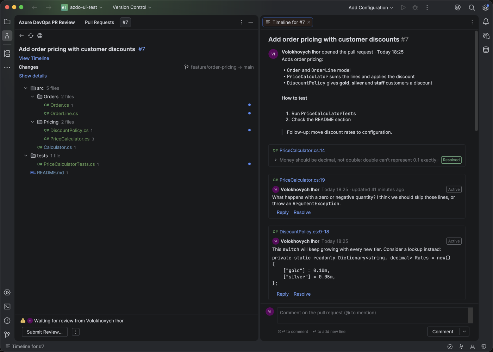
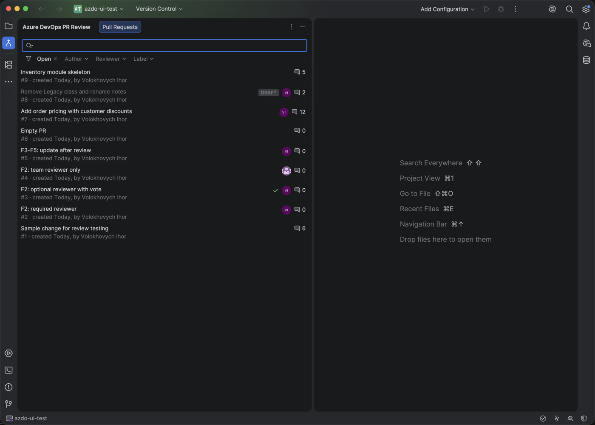
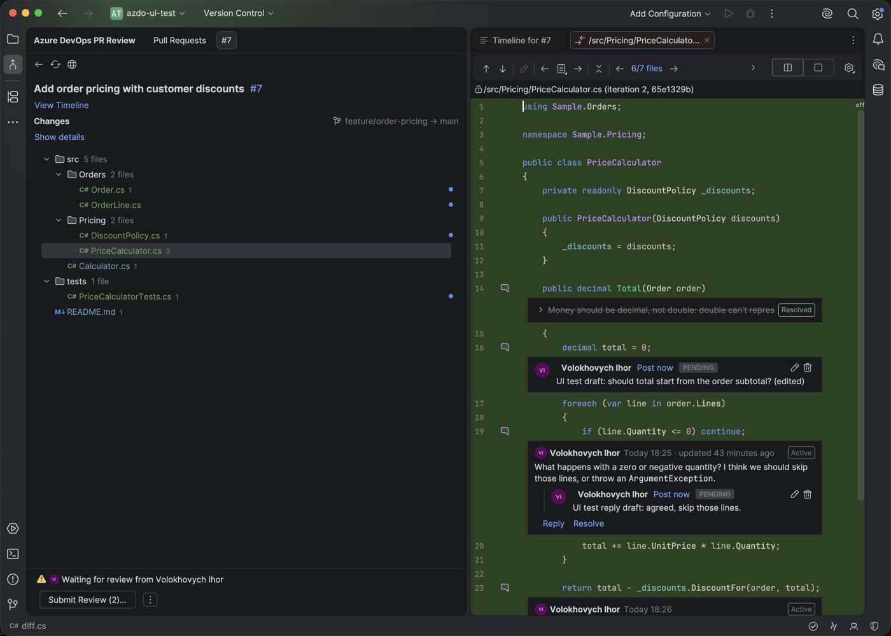
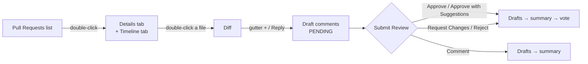
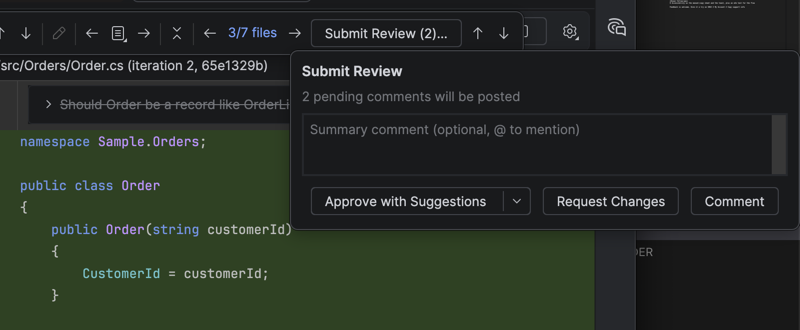

<div align="center">

# Azure DevOps PR Review

**Review Azure DevOps pull requests without leaving Rider.**

Browse, read, comment and vote, the way JetBrains' GitLab integration does it, for Azure DevOps.

[](https://github.com/antomys/rider-azdo-pr-review/releases/latest)
[](https://www.jetbrains.com/rider/)
[](https://learn.microsoft.com/en-us/rest/api/azure/devops/git/pull-requests?view=azure-devops-rest-7.1)
[](https://kotlinlang.org)


[Install](#-install) · [Features](#-features) · [How a review works](#-how-a-review-works) · [Development](#-development) · [Docs](#-documentation)

<br>



</div>

---

## ✨ Features

| | |
|---|---|
| 🔎 **Find the right pull request** | Search by title, number, author or branch. Filter with chips for state, author, reviewer and label. Each row shows the draft badge, reviewer avatars with their votes, and the comment count. |
| 🧭 **Timeline** | Opening a pull request shows its description, discussion and events (pushes, votes) in order, in an editor tab. |
| 🗂 **Files tree** | Folders with file counts, file-type icons, change colors, comment counts, and a blue dot on every file you haven't viewed yet. |
| 🧾 **Side-by-side diff** | One reused diff tab. Threads sit right under their lines. Resolved threads fold into a single line. Gutter markers show where the comments are. |
| 💬 **Comment like in the web UI, but faster** | Add a comment from the gutter on a line or a selection. Reply, resolve and reopen, and **@mention** people from your project. |
| 📝 **Drafts by default** | Comments are held as drafts until you're done. **Submit Review** then sends them all, followed by your summary comment and your vote. |
| ✅ **Every vote** | Approve, approve with suggestions, request changes, reject, or just comment. Approve with suggestions is offered automatically while you have open comments. |
| 🧰 **Review tools** | "← 1/7 files →" with a files popup, next and previous comment, viewed marks that reset when a file changes, and Request Review, Merge and Close actions. |

<table>
  <tr>
    <td width="50%"></td>
    <td width="50%"></td>
  </tr>
  <tr>
    <td align="center"><sub>Pull requests: search, filters, votes and comment counts at a glance</sub></td>
    <td align="center"><sub>Review: inline threads and pending drafts, sent together</sub></td>
  </tr>
</table>

## 🚀 Install

**Requirements:**
- JetBrains Rider **2026.2** (tested on macOS);
- an Azure DevOps Services organization (`dev.azure.com`).

### With the script (macOS, Linux)

With the [GitHub CLI](https://cli.github.com) signed in to an account that can read this repository:

```sh
scripts/install-plugin.sh                   # latest release
scripts/install-plugin.sh --version v0.1.0  # a specific release
scripts/install-plugin.sh --zip FILE        # a zip you downloaded
scripts/install-plugin.sh --build           # build this checkout and install it
```

Then restart Rider. Running the script again updates the plugin.

### By hand (any OS)

1. Download `rider-azdo-pr-review-<version>.zip` from [Releases](https://github.com/antomys/rider-azdo-pr-review/releases).
2. In Rider, open **Settings | Plugins | ⚙ | Install Plugin from Disk…**, choose the zip, and restart Rider.

### Connect to Azure DevOps

Open **Settings | Tools | Azure DevOps PR Review** and fill in:

| Field | What to enter |
|---|---|
| Organization | The name in `https://dev.azure.com/<organization>` |
| Personal access token | A token with **Code (Read & write)**, **Identity (Read)** and **Graph (Read)** |
| Project, Repository | The repository whose pull requests you review |

Then open the **Azure DevOps PR Review** tool window on the left.

> [!TIP]
> Prefer a short-lived token scoped to one organization. Azure DevOps stops accepting global tokens on 1 December 2026.

## 🧑‍💻 How a review works



1. **Pick a pull request** in the list and double-click it. Its details tab and timeline open.
2. **Double-click a file** in the tree to start reviewing. Use **← →** or the **N/M files** popup to move between files, and **↑ ↓** to jump between comments.
3. **Comment** from the gutter **+**: on one line, or on the lines you selected. **⌘⏎** saves a draft; **Post Now** in the drop-down sends it right away.
4. **Submit Review (N)…** opens the popup. Add an optional summary and choose how to finish. Your drafts are posted first, then the summary, then the vote.

<p align="center"></p>

## 🔒 Privacy and security

- The token is kept in the IDE's password storage (the macOS Keychain on a Mac). It's never written to settings files, logs or error messages.
- The plugin talks only to your Azure DevOps organization. No telemetry, no AI services, no third parties.
- Viewed marks and drafts stay on your machine.

## 🛠 Development

**Toolchain:**
- Kotlin 2.4 and the IntelliJ Platform Gradle Plugin 2.19;
- a JDK 25 toolchain (Gradle provisions one if none is found);
- built against Rider 2026.2.2.

```sh
./gradlew test buildPlugin verifyPlugin -PplatformLocalPath=/Applications/Rider.app   # tests, zip, plugin verifier
./gradlew runIde -PplatformLocalPath=/Applications/Rider.app                          # a sandbox Rider with the plugin
```

- Without `platformLocalPath`, Gradle downloads Rider 2026.2.2.
- Tests replay recorded, anonymised Azure DevOps responses from `src/test/resources/fixtures/azdo` and make no network calls.
- The plugin verifier must report **Compatible**, with no internal or deprecated API use.

```
src/main/kotlin/io/github/antomys/azdoprreview/
├── azdo/        Azure DevOps REST client and provider
├── review/      provider-neutral review model and ReviewProvider
├── settings/    settings page, token storage, viewed marks
├── toolwindow/  pull request list, details tab, files tree, Submit Review
├── timeline/    "Timeline for #id" editor tab
├── diff/        review diff, inline threads and drafts, toolbar
└── ui/          comment box, threads, drafts, avatars, Markdown
```

**Contributing:**
- Work on a branch and open a pull request.
- Read [`docs/product-baseline.md`](docs/product-baseline.md) first. It describes the approved behavior, which changes only with the owner's approval.
- Coding agents start from [`CLAUDE.md`](CLAUDE.md) and the [project wiki](wiki/index.md).

## 📚 Documentation

| Document | What's in it |
|---|---|
| [Product baseline](docs/product-baseline.md) | What 0.1.0 does, screen by screen |
| [Engineering notes](docs/engineering-notes.md) | Verified platform pitfalls and Azure DevOps API facts |
| [Plan and specification](docs/plan.md) | Original research, feature mapping, architecture |
| [F1–F5](docs/features/F1-F5.md) | Next features: sign-in, assigned to me, reviewed marking, update detection, update view |
| [Risks](docs/risks.md) · [Open decisions](docs/open-decisions.md) | Risks with mitigations; decisions with their defaults |
| [Sandbox plan](docs/sandbox-plan.md) · [Inventory](docs/sandbox-inventory.md) | Test pull requests and everything created in the sandbox |
| [Wiki](wiki/index.md) | Agent-maintained map of the project |

## 🗺 Roadmap

Not in 0.1.0 yet:
- threads in the unified diff view;
- sign-in prompt and token renewal (F1);
- team-aware "Assigned to me" (F2);
- reviewed marking, update detection and the "what changed since I last looked" view (F3–F5);
- an opt-in AI review that posts its findings as threads, after you've previewed them.

---

<div align="center">
<sub>Not affiliated with Microsoft or JetBrains. Azure DevOps and Rider are trademarks of their respective owners.</sub>
</div>
